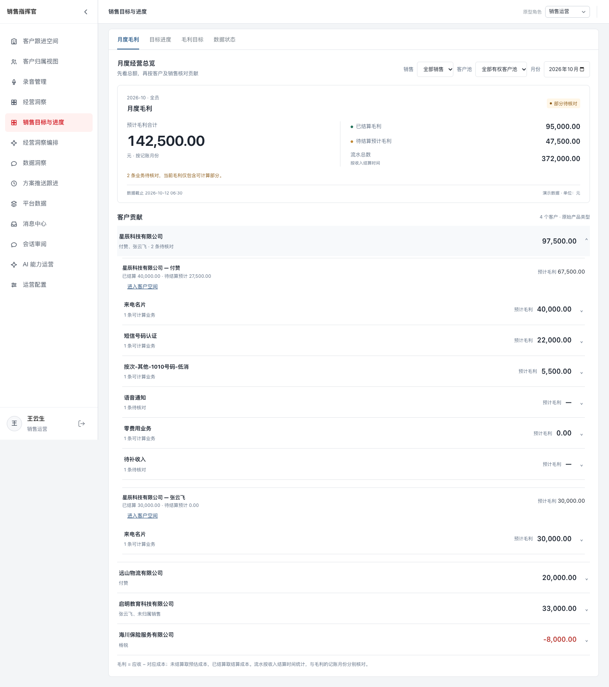
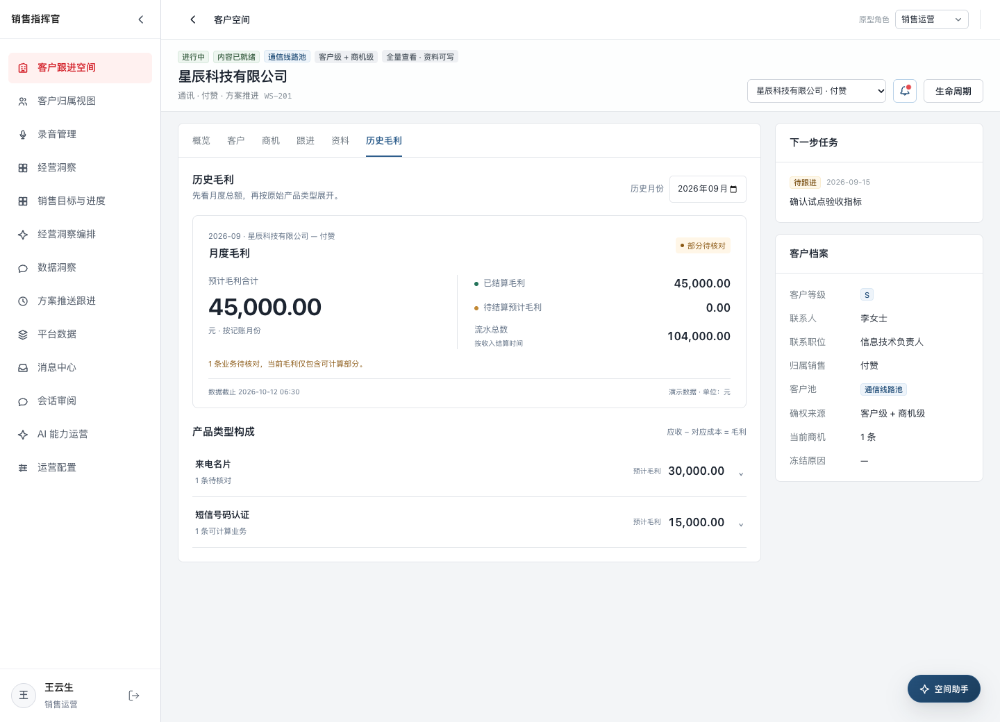
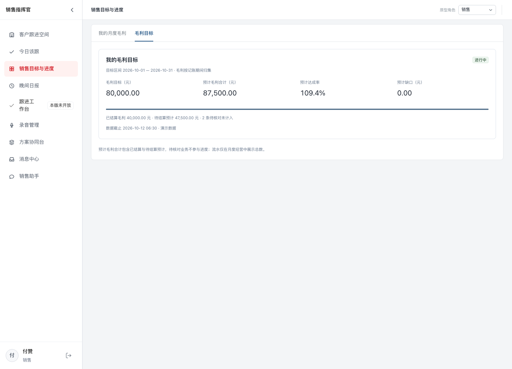
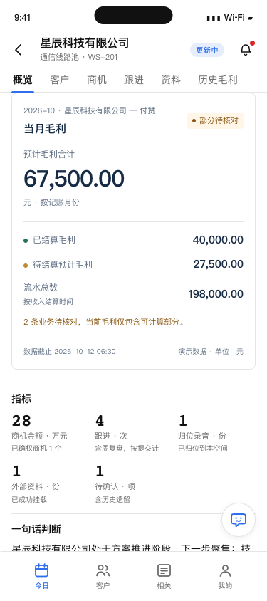
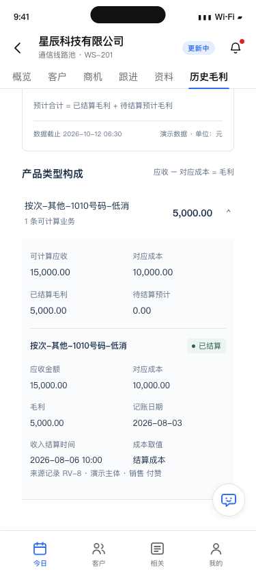
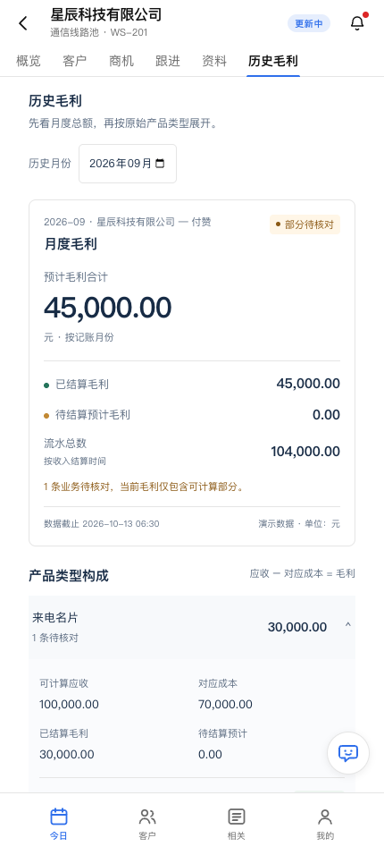

# 2026-10-12 毛利模块原型验收

## 实现范围

本轮更新 V0.2 本地原型，静态预览仍运行在 `http://localhost:4173`。生产前后端和 DataHub 正式同步未在本轮实施。页面上的客户及金额为虚构演示数据。

| 模块 | 已更新展示与交互 |
| --- | --- |
| 销售目标与进度 | 默认月度毛利；先总额再客户、产品；运营可按销售、客户池、月份筛选，客户内先拆销售绑定；方案人员可通过评审直达入口查看当前承接范围。 |
| 毛利目标 | 只录入个人或全员毛利目标；以预计合计计算达成及缺口；支持录入、调整原因、调整记录；超管只读。 |
| 客户空间 | 概览当月卡片；第六个「历史毛利」Tab；历史月份切换、刷新保留月份、原始产品及业务明细展开；当月卡片不随历史选择改变。 |
| 移动端 | 与桌面共用规则及卡片；空间六页签；历史切月与产品展开；今日展示本月毛利、流水与毛利目标进度。 |
| 数据状态 | 缺失金额待核对且不计进度；明确零有效；未覆盖月份显示暂无数据；失败保留上次成功结果及截止时间；从未成功不显示虚构完成值。 |

## 展示字段与口径

| 展示项 | 数据来源或计算 | 使用位置 |
| --- | --- | --- |
| 客户—销售绑定 | 演示收入的客户与销售对应；不用跟进人替代销售 | 月度客户构成、客户空间 |
| 产品类型 | 保留原始产品类型，含「按次-其他-1010号码-低消」 | 产品构成与明细 |
| 应收 | 收入应收金额 | 毛利计算及明细 |
| 对应成本 | 未结算取预估成本金额；已结算取结算成本金额 | 毛利计算及明细 |
| 预计毛利合计 | 应收减成本，包含已结算与待结算预计，每项只计一次 | 汇总、目标进度 |
| 已结算毛利 | 收入结算时间有值、成本已结算且所需金额完整 | 汇总构成 |
| 待结算预计毛利 | 可计算且未同时满足两侧结算 | 汇总构成 |
| 毛利月份 | 记账月份；跨月结算重算原月份 | 月度与历史 |
| 流水总数 | 按收入结算月份汇总结算金额 | 月度卡片，不设流水目标 |
| 数据截止及待核对 | 最近成功同步时间、缺失金额或配对异常 | 卡片说明、数据状态 |

原型用显式的已核对关系演示收入与成本配对，核对客户、销售、原始产品、我方主体和记账月。正式配对规则、币种与历史数据覆盖仍按 R17 待明确事项推进。未授权的历史客户明细不因保留本人历史业绩而恢复；冻结空间的财务明细显示权限待核对。

## 验证结果

Docker 内执行以下命令，**80 项通过，0 失败**：

```sh
docker exec qt2-v02-prototype node --test tests/features.cjs tests/login.cjs tests/page-navigation.cjs tests/mobile.cjs tests/mobile-chat.cjs
```

已验证：应收与结算金额不同、收入先结算而成本未结算、后续结算修正原记账月、缺成本/缺应收/缺结算成本、明确零、负毛利、重复数据、同客户不同销售隔离、方案承接变更、冻结明细边界、停用账号、目标录入调整、零目标不除法及无目标不伪造零缺口。旧本地财务样例升级后保留原始财务快照、毛利目标调整和其他模块内容。

修改的共享 JavaScript 通过容器内 `node --check`；移动端合并脚本与 7 个组件源文件逐项一致。

真实浏览器验收使用**宿主机 Playwright + 系统 Chrome**，静态服务与回归测试在 Docker 中。已检查运营筛销售/月份、客户销售构成、目标保存与调整记录、超管只读、管理身份打开客户空间仍按空间销售计算，以及移动端 375px / 390px 概览、历史切月和产品明细；无页面脚本错误、无页面横向溢出。已人工查看截图，确认金额、明细和抽屉完整可读。

## 评审入口

- [销售本人月度](../pages/sales-goals.html?role=SLS&as=U-1004)
- [运营月度](../pages/sales-goals.html?role=MGR&as=U-1002)
- [毛利目标维护](../pages/sales-goals.html?role=MGR&as=U-1002&tab=manage)
- [空间当月卡片](../pages/followup-workbench.html?role=SLS&as=U-1004&space=WS-201&tab=overview)
- [空间历史毛利](../pages/followup-workbench.html?role=SLS&as=U-1004&space=WS-201&tab=profit)
- [移动空间](../mobile-ios-sales-assistant/pages/mobile-ios.html?as=U-1004#/space/WS-201/overview)
- [方案承接范围](../pages/sales-goals.html?role=SOL&as=U-1010)（正式导航位置待评审）

## 截图

运营先按客户—销售绑定展开：



客户空间历史月份：



毛利目标预计进度与结算构成：



移动端当月卡片及原始产品明细：





其余截图：[销售月度](20261012-毛利截图/sales-monthly.png)、[移动历史毛利](20261012-毛利截图/mobile-history-375.png)、[目标调整记录](20261012-毛利截图/goal-adjustment.png)。

## 2026-10-13 桌面浏览器内手机预览溢出修复

发现历史毛利与当月卡片在宽浏览器窗口内被截断：手机预览框限宽 430px，但财务样式仅按浏览器视口应用窄屏断点，导致宽窗口里仍使用最少 450px 的双栏金额区。现已给 iOS 原型固定应用移动布局，单栏汇总、两列产品明细及移动端间距不再受外部浏览器宽度影响；桌面月度页仍保持双栏。

宿主机 Playwright + 系统 Chrome 复核 320 / 375 / 390 / 430 / 768 / 1440 / 1920px，每个宽度检查历史毛利（含产品展开）与概览，14 个场景均通过。检查直接比较财务元素与手机框的左右边界，避免外层隐藏溢出造成误判；修复前在宽窗口两页各有 10 个越界元素，修复后均为 0，无页面脚本错误。


