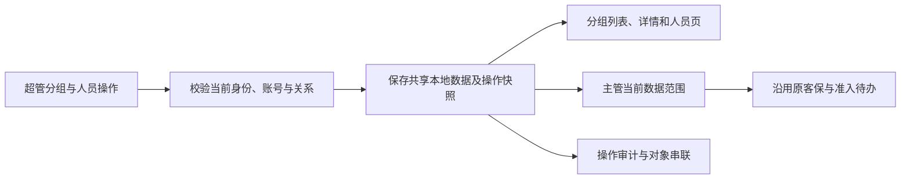

# M02 原型数据联动验收报告

验收日期：2026-09-09。对象：当前工作区 HTML 原型。本报告核验本地模拟数据的可运行行为，不代表真实后端、CRM 或 Agent 联调验收。

## 1. 需求依据与结论

- [M02-1 角色默认菜单与职责](../../PRD/PRD-01-客户数据装载与工作空间建立/M02-角色与权限管理/M02-1-角色默认菜单与职责需求文档.md)：四角色菜单、默认职责、必要查询信息与经营内容隔离、当前关系与历史授权、工作台统计。
- [M02-2 销售主管与销售分组](../../PRD/PRD-01-客户数据装载与工作空间建立/M02-角色与权限管理/M02-2-销售主管与销售分组需求文档.md)：分组命名、首次分配、待分组名单、正式主管继任及转岗关系解除。
- 角色变更前置条件同时遵循 M01：先停用账号，处理归属、任职、客户池及未完成事项，改角色后另行启用。事件记录消费 M03 的分组建立、成员关系调整和主管指派口径。

**M02-2 本期分组维护与主管继任的本地演示闭环通过；M02-1 本轮涉及的菜单、默认首页、身份保持、前端范围校验和统计联动检查通过。** 原有客户池、客保、准入、交接与空间历史流程通过回归。系统级权限一致性仍须在真实服务接入后验收。

本次沿用原型既有的“一名主管管理一个分组”限制。PRD 明确规定“一组一主管”；未自行扩展成一名主管管理多个分组，也未修改 PRD 业务规则。

## 2. 已实现的数据流

分组以固定标识关联成员，改名仅更新当前显示名称。主管权限以当前负责人关系判定，不能凭人员的组名文本取得权限。首次分配不改变商机归属。继任不创建新审批，不替换历史审批人，不自动启停账号。每次提交重新检查当前数据；两个页面同时提交时，只有符合最新关系的一方能生效，冲突项返回原因。

已将旧的分组静态数据投影接入同一数据源；客户、组合、当前空间、归档历史分别统计。原型重置恢复初始演示数据，不从已变更的页面投影重新生成“初始状态”。

## 3. 对应页面验收标准与结果

### M02-2

| 编号 | 页面／入口 | 验收步骤与通过标准 | 结果 |
| --- | --- | --- | --- |
| G01 | [销售分组](../pages/groups.html)，P-ADM-05 | 创建时分别提交空名称、重复名称、未选主管、非主管或停用主管；均不能创建。有效名称与可用主管创建一组，允许无成员，刷新后仍存在。取消不改变分组数。 | 通过 |
| G02 | [分组详情](../pages/group-detail.html)，P-ADM-06 | 修改名称：空值、重名被阻止；有效新名称同步至分组列表、详情及主管页面。原商机归属、审批记录和组标识不改变。 | 通过 |
| G03 | 分组详情→加入成员 | 搜索真实筛选名单；已分组销售显示当前分组且不可选，停用销售不可选；无有效勾选不能提交。成功后成员与数量更新，刷新仍有效。 | 通过 |
| G04 | 销售分组→待分组销售 | 常驻人数和名单包含账号状态、进入时间、客户数、组合数及空间数；合法项可批量指定。完成后从待分组名单移出，全部完成显示明确空态。 | 通过 |
| G05 | 两个分组页面 | 两页同时首次分配同一销售，仅一方成功；另一方返回已分组原因。同批其他合法销售继续加入，返回逐条成功／失败结果，不开放自由转组。 | 通过 |
| G06 | 待分组销售→本人客户→主管客户 | 未分组销售仍可见本人组合；普通准入提示需先分组。首次分配后主管立即获得该销售的组合范围，原商机归属不变；固定超管事项仍使用原规则。 | 通过，含既有客保回归 |
| G07 | 分组详情→主管继任 | 显示原主管、有效候选人与当前待办影响；确认后替换唯一主管。新主管按现有规则接手原未完成待办，旧主管旧页面被拒绝；原账号状态、历史审批人及结果保持。 | 通过 |
| G08 | 两页同时主管继任 | 两页使用同一旧版本确认不同继任人，只有一个结果生效；后提交者提示关系变化。重复确认、停用候选、非主管不能覆盖。 | 通过 |
| G09 | 人员页→主管停用→主管继任 | 未完成待办不阻止账号停用；停用者不能访问，超管保持兜底权。继任可在原主管停用后办理，不自动重新启用原账号。 | 通过 |
| G10 | [人员详情](../pages/people-detail.html)→角色变更 | 已启用账号、仍有商机（包括已结束／未激活）、仍任主管、仍在客户池或有未完事项均阻止转岗，并提供处理入口。条件满足后变更角色，解除原销售成员关系，账号保持停用，历史记录不改写。 | 通过 |
| G11 | [待分配角色池](../pages/role-pool.html)→人员列表 | 为待分配人员分配角色后移出待分配池，仍需手动启用。启用的新主管可成为创建分组的候选人。 | 通过 |
| G12 | [操作审计](../pages/audit-query.html)→详情／对象串联 | 本轮创建与指派、分配、继任、角色变更产生实际记录；可按域／类型查询、打开前后快照，并以分组或人员标识串联。取消、无效及重复确认不生成成功结果。 | 通过 |

### M02-1

| 编号 | 页面／入口 | 验收步骤与通过标准 | 结果 |
| --- | --- | --- | --- |
| R01 | 主框架与[登录页](../pages/login.html) | 超管、主管、销售、方案人员分别为 10／8／9／3 个菜单；登录进入人员与账号、主管工作台、销售工作台、本期临时首页“我的客户池”。停用及无有效角色不可登录。 | 通过，30 个菜单 |
| R02 | 分组、人员、审计等管理页直链 | 使用销售身份直接访问管理列表及详情，应无权访问；直接打开销售首页后调用分组提交逻辑也不能维护分组。 | 通过 |
| R03 | [客户档案](../pages/customer-detail.html)→页签→后续 PRD 空态页→我的客户 | 页面显示的姓名与实际读取身份始终一致，切换页签、刷新及返回菜单不丢失当前人员。后续 PRD 菜单保留正常空态。 | 通过 |
| R04 | [主管工作台](../pages/manager-home.html)、[本组销售](../pages/manager-sales.html) | 只见当前主管负责的分组，不能靠同名组字段取得权限；首次分配、改名、继任后名单与统计使用最新关系。当前空间与归档历史分别统计。 | 通过 |
| R05 | [销售工作台](../pages/sales-home.html) | 无本人组合显示空态；近 30 天跟进按本人归属商机去重，并按当前客户池统计。未分池数量单列且不进分母；全部未分池不误报无跟进；未来记录不计入窗口。 | 通过 |
| R06 | 我的客户、本组客户、组合与工作空间 | 原有本人／本组组合范围、产品激活条件及多池三元空间逻辑保持；分组更新不改变销售归属、准入审批或工作空间内容。 | 通过，专项与既有回归 |
| R07 | 我的客户池、客户提报、工作空间 | 方案侧本池范围与混合正文隔离继续生效；失权后不恢复经营内容；转岗后不因过去销售历史授权取得额外权限。 | 已有场景回归通过；真实音频及 Agent 见范围说明 |
| R08 | 客保、准入、交接、空间历史 | 首批整单、后续逐条审批、释放／公海／恢复、两道审批独立、整体迁移、拆分历史授权与空置归档继续按原规则运行。 | 既有 22 组流程通过 |

## 4. 自动化与页面检查

| 检查 | 结果 | 依据 |
| --- | --- | --- |
| M02 专项流程 | 22 组通过，0 失败 | [测试脚本](../tests/m02-flows.cjs)、[逐组结果](M02-验收结果.json) |
| 导航、返回、角色与退出 | 12 项通过 | `tests/page-navigation.cjs` |
| 客户池、产品、客户、CRM数据管理等既有流程 | 16 组通过 | `tests/batch2-flows.cjs` |
| 客保、准入、交接及空间历史既有流程 | 22 组通过 | `tests/batch3-flows.cjs` |
| M02 桌面页面与弹窗 | 7 个视图 × 1440／1280 宽度，14 次检查通过 | 销售分组、待分组、详情、加入成员、继任、创建及角色检查 |
| 全量业务页面与窄窗口 | 16＋34 个页面，1440／1280／390 三种宽度均通过，无页面脚本错误 | `tests/batch2-smoke.cjs`、`tests/batch3-smoke.cjs` |

测试在独立 Chrome 上下文中使用虚构数据。并发场景使用同一上下文的两个页面；不会写入使用者已有浏览器状态。原有页面冒烟测试在调整窗口尺寸后立即测量，改动前版本也出现同类瞬时失败；现已等待响应式布局完成再判断，持续溢出仍会失败。

## 5. 人工复验路径与截图

1. 从“人员与账号→待分配角色池”为一位演示人员分配“销售主管”，返回人员列表手动启用。
2. 进入“销售分组”，使用该主管创建新组，打开详情，加入待分组销售。
3. 使用主管页面的“原型人员”选择该主管，查看本组销售、客户和待办；刷新后再次核对。
4. 为另一位可用主管办理继任，再切回原主管查看旧页面，应失去原组权限。
5. 回到超管“操作审计”，查看新事件及主管前后快照。

| 页面 | 截图 |
| --- | --- |
| 分组列表与实时统计 | [销售分组](M02-截图/01-销售分组.png) |
| 待分组人数与名单 | [待分组销售](M02-截图/02-待分组销售.png) |
| 成员与当前／历史空间 | [分组详情](M02-截图/03-分组详情.png) |
| 可用性、已分组禁选和搜索 | [加入成员](M02-截图/04-加入成员.png) |
| 原主管、新主管与真实待办影响 | [主管继任](M02-截图/05-主管继任.png) |
| 转岗前置检查 | [角色检查](M02-截图/06-角色变更检查.png) |
| 继任前后关系快照 | [审计详情](M02-截图/07-主管继任审计.png) |
| 全部跟进商机未分池的正确提示 | [工作台](M02-截图/08-未分池商机统计.png) |

## 6. 本次验收边界

业务数据保存在浏览器 `localStorage`，登录演示身份与筛选状态使用 `sessionStorage`。刷新和同来源跨页共享已验证；不同浏览器、不同电脑不共享。清除站点数据或使用原型重置，会清除相应演示变更。

- 登录仍为原型演示账号匹配，启停与当前角色读取共享数据；页面上的角色／人员选择器用于演示，不构成生产鉴权。
- 本次验收不替代后端权限校验、真实 CRM 同步、跨电脑多用户并发或数据库持久化验收。
- 真实录音、跨池安全版本生成、Agent 证据与外部接口共用权限，仍需对应后续模块接入后验收；当前验证的是已有本地正文与空间授权示例。
- M01 的完整新增人员、导入、密码管理以及 PRD-02～06 的其他业务内容不由本轮联动扩展；角色分配、转岗检查和账号状态衔接已接通。
